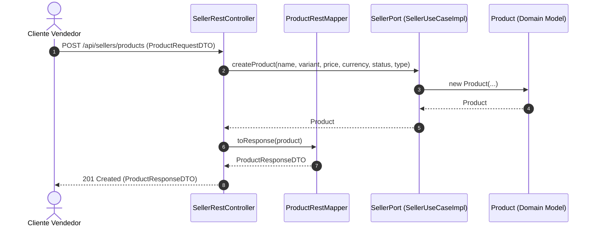

# Adaptadores REST y Controladores: NexusMarket

## 1. Principios de Diseño
Los controladores REST bajo `application.adapters.rest.controllers` son adaptadores primarios orientados 1 a 1 con los **Actores del Sistema**:
- Nunca acceden a repositorios ni a bases de datos directamente.
- Inyectan única y exclusivamente interfaces de puertos de entrada (`PublicAccessPort`, `BuyerPort`, `SellerPort`, `AdministratorPort`, `SupervisorPort`, `LogisticsOperatorPort`).
- Transforman payloads JSON a objetos DTO (`*RequestDTO`) y respuestas de dominio a DTOs de salida (`*ResponseDTO`) mediante mappers desacoplados (`*RestMapper`).

---

## 2. Catálogo Oficial de Controladores por Actor

| Controlador (`*RestController`) | Ruta Base | Puerto de Entrada Inyectado | Actor / Responsabilidad |
|---|---|---|---|
| `AuthRestController` | `/api/auth` | `PublicAccessPort` | Autenticación pública (login) y registro de compradores. |
| `BuyerRestController` | `/api/buyers` | `BuyerPort` | Carrito de compras, creación/consulta de pedidos, pagos y devoluciones. |
| `SellerRestController` | `/api/sellers` | `SellerPort` | Registro de vendedores, gestión de catálogo de productos, variantes, precios y órdenes de venta. |
| `AdministratorRestController` | `/api/admin` | `AdministratorPort` | Registro de Staff/vendedores, control de estado de usuarios, facturación fiscal y bitácora de operaciones. |
| `SupervisorRestController` | `/api/supervisors` | `SupervisorPort` | Resolución de disputas, aprobación/rechazo de devoluciones, emisión de reembolsos y auditoría de pedidos. |
| `LogisticsOperatorRestController` | `/api/logistics` | `LogisticsOperatorPort` | Actualización de despachos/entregas, avance de estados de orden y registro de movimientos de inventario. |

---

## 3. Convenciones de Nomenclatura
- **Controladores:** Sufijo `*RestController.java` en `application.adapters.rest.controllers`.
- **DTOs de Entrada:** Sufijo `*RequestDTO.java` en `application.adapters.rest.dtos.requests`.
- **DTOs de Salida:** Sufijo `*ResponseDTO.java` en `application.adapters.rest.dtos.responses` (incluyendo `AuditLogResponseDTO` y `AuditLogPageResponseDTO`).
- **Mappers:** Sufijo `*RestMapper.java` en `application.adapters.rest.mappers` (incluyendo `AuditLogRestMapper`).
- **Excepciones:** `GlobalExceptionHandler.java` en `application.adapters.rest.exception`.

---

## 4. Ejemplo de Flujo de Transformación

