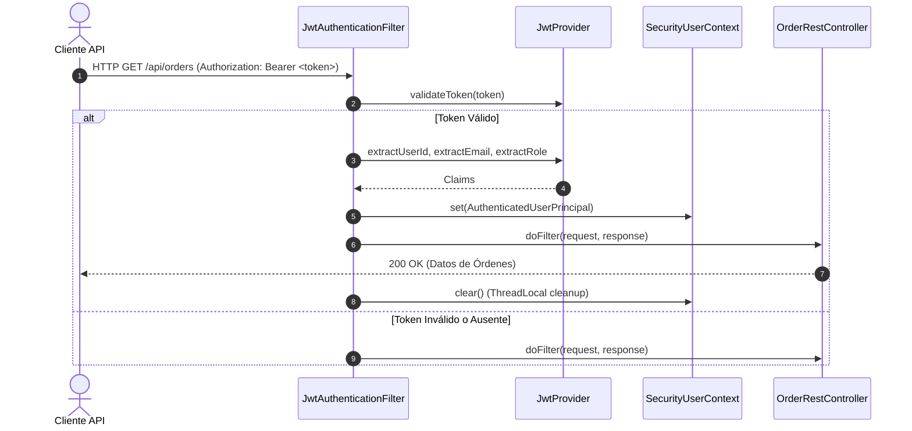

# Seguridad REST, JWT y CORS: NexusMarket

## 1. Visión General de Seguridad
NexusMarket implementa seguridad stateless basada en tokens Bearer JWT:
- Algoritmo de firma: HMAC-SHA256 (`HmacSHA256`).
- Implementación criptográfica pura sin librerías externas pesadas (`JwtProvider` bajo `application.adapters.security`).
- Intercepción de peticiones HTTP mediante `JwtAuthenticationFilter` (`OncePerRequestFilter`).
- Contexto de usuario en memoria seguro para hilos concurrentes (`SecurityUserContext` con `ThreadLocal`).

---

## 2. Flujo de Autenticación y Autorización

---

## 3. Configuración CORS (`SecurityConfig`)
- Orígenes permitidos: Configurable (por defecto comodín `*` para entornos de desarrollo y pruebas).
- Métodos permitidos: `GET`, `POST`, `PUT`, `PATCH`, `DELETE`, `OPTIONS`.
- Encabezados permitidos: `Authorization`, `Content-Type`, `Accept`, `Origin`, `X-Requested-With`.
- Credenciales: Soportadas (`AllowCredentials = true`).
