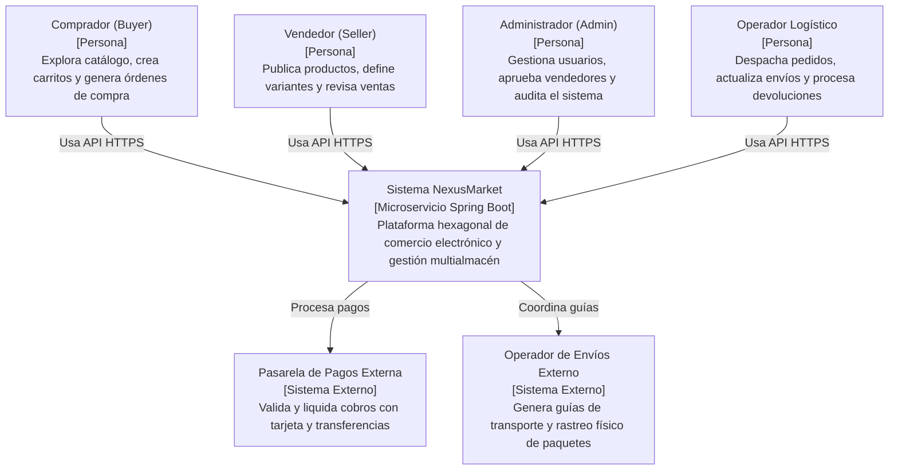

# C4 - Nivel 1: Diagrama de Contexto del Sistema

## 1. Diagrama de Contexto
El siguiente diagrama muestra el sistema NexusMarket en relación con sus usuarios humanos y los sistemas externos circundantes:

---

## 2. Descripción de Entidades de Contexto
- **Comprador:** Realiza el recorrido de compra de punta a punta.
- **Vendedor:** Monitorea su inventario y catálogo de productos.
- **Administrador:** Garantiza la seguridad y cumplimiento regulatorio.
- **Operador Logístico:** Gestiona los movimientos en almacenes físicos.
- **Sistemas Externos:** Integración futura mediante puertos de salida para procesamiento de pagos bancarios y empresas de transporte de carga.
