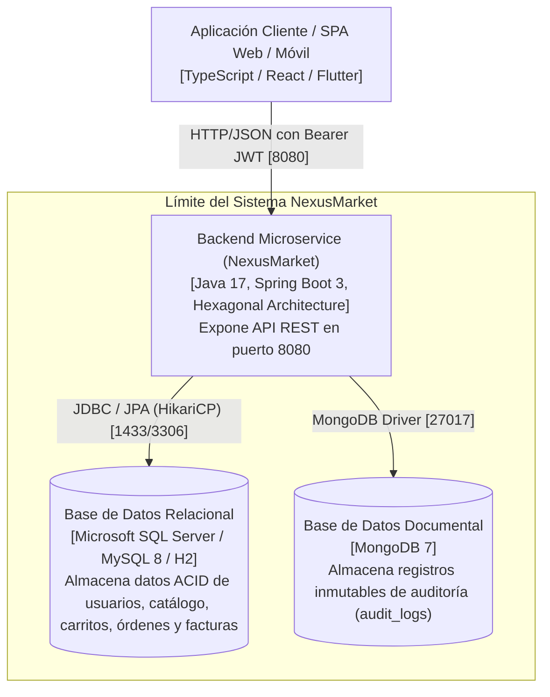

# C4 - Nivel 2: Diagrama de Contenedores

## 1. Diagrama de Contenedores
El diagrama de contenedores describe la arquitectura física de despliegue de NexusMarket:

---

## 2. Contenedores y Tecnologías

### 2.1 Backend Microservice (`nexusmarket-backend`)
- **Tecnología:** Java 17 Temurin, Spring Boot, Spring Data JPA, Spring Data MongoDB.
- **Responsabilidad:** Implementa la lógica de negocio pura, autenticación JWT, validaciones de catálogo, transiciones de estado de órdenes y facturación fiscal.

### 2.2 Base de Datos Relacional (`nexusmarket-sql`)
- **Tecnología:** SQL Server / MySQL / H2 en memoria para pruebas.
- **Responsabilidad:** Garantiza la integridad transaccional ACID, unicidad de documentos de identidad y correos electrónicos.

### 2.3 Base de Datos NoSQL (`nexusmarket-mongodb`)
- **Tecnología:** MongoDB 7.
- **Responsabilidad:** Bitácora inmutable de eventos de auditoría (`audit_logs`) con alta concurrencia de escritura.
