# C4 - Nivel 3: Diagrama de Componentes

## 1. Diagrama de Componentes del Backend NexusMarket
Muestra los componentes internos y su interacción a través de los puertos hexagonales orientados a actores:

```mermaid
graph TD
    subgraph REST_Controllers ["Controladores REST por Actor (application.adapters.rest.controllers)"]
        AuthCtrl["AuthRestController"]
        BuyerCtrl["BuyerRestController"]
        SellerCtrl["SellerRestController"]
        AdminCtrl["AdministratorRestController"]
        SuperCtrl["SupervisorRestController"]
        LogistCtrl["LogisticsOperatorRestController"]
    end

    subgraph Inbound_Ports ["Puertos de Entrada por Actor (application.domain.ports.in)"]
        PublicAccessPort["PublicAccessPort"]
        BuyerPort["BuyerPort"]
        SellerPort["SellerPort"]
        AdminPort["AdministratorPort"]
        SupervisorPort["SupervisorPort"]
        LogisticsPort["LogisticsOperatorPort"]
    end

    subgraph UseCases_Impl ["Implementaciones de Casos de Uso (application.adapters.useCases)"]
        PublicAccessUC["PublicAccessUseCaseImpl"]
        BuyerUC["BuyerUseCaseImpl"]
        SellerUC["SellerUseCaseImpl"]
        AdminUC["AdministratorUseCaseImpl"]
        SupervisorUC["SupervisorUseCaseImpl"]
        LogisticsUC["LogisticsOperatorUseCaseImpl"]
    end

    subgraph Domain_Services ["Servicios de Dominio (application.domain.services)"]
        UserServices["user/*Services"]
        ProductServices["product/*Services"]
        InventoryServices["inventory/*Services"]
        OrderServices["order/*Services"]
        BillingServices["billing/*Services"]
        LogisticsServices["logistics/*Services"]
        OperationServices["operation/*Services"]
        AuthServices["authorization/*Services"]
    end

    subgraph Outbound_Ports ["Puertos de Salida (application.domain.ports.out)"]
        UserRepoPort["UserRepositoryPort"]
        ProdRepoPort["ProductRepositoryPort"]
        CartRepoPort["ShoppingCartRepositoryPort"]
        OrderRepoPort["OrderRepositoryPort"]
        InvRepoPort["InvoiceRepositoryPort"]
        OpRepoPort["OperationRepositoryPort"]
        AuditRepoPort["AuditLogRepositoryPort"]
        JwtPort["JwtServicePort"]
        PassPort["PasswordServicePort"]
        AuthPort["AuthorizationPort"]
    end

    subgraph Secondary_Adapters ["Adaptadores Secundarios (application.adapters.persistence & security)"]
        UserJpa["UserJpaAdapter"]
        ProdJpa["ProductJpaAdapter"]
        CartJpa["ShoppingCartJpaAdapter"]
        OrderJpa["OrderJpaAdapter"]
        InvJpa["InvoiceJpaAdapter"]
        OpJpa["OperationJpaAdapter"]
        AuditMongo["AuditLogMongoAdapter"]
        JwtProv["JwtProvider"]
        PassAdapter["BCryptPasswordServiceAdapter"]
        UserDetailsAdapter["NexusMarketUserDetailsAdapter"]
    end

    AuthCtrl --> PublicAccessPort
    BuyerCtrl --> BuyerPort
    SellerCtrl --> SellerPort
    AdminCtrl --> AdminPort
    SuperCtrl --> SupervisorPort
    LogistCtrl --> LogisticsPort

    PublicAccessPort -.-> PublicAccessUC
    BuyerPort -.-> BuyerUC
    SellerPort -.-> SellerUC
    AdminPort -.-> AdminUC
    SupervisorPort -.-> SupervisorUC
    LogisticsPort -.-> LogisticsUC

    PublicAccessUC --> UserServices
    BuyerUC --> OrderServices
    SellerUC --> ProductServices
    AdminUC --> BillingServices
    SupervisorUC --> AuthServices
    LogisticsUC --> InventoryServices

    PublicAccessUC --> UserRepoPort
    PublicAccessUC --> JwtPort
    BuyerUC --> CartRepoPort
    BuyerUC --> OrderRepoPort
    SellerUC --> ProdRepoPort
    AdminUC --> InvRepoPort
    AdminUC --> OpRepoPort
    SupervisorUC --> OpRepoPort
    LogisticsUC --> OrderRepoPort

    UserRepoPort -.-> UserJpa
    ProdRepoPort -.-> ProdJpa
    CartRepoPort -.-> CartJpa
    OrderRepoPort -.-> OrderJpa
    InvRepoPort -.-> InvJpa
    OpRepoPort -.-> OpJpa
    AuditRepoPort -.-> AuditMongo
    JwtPort -.-> JwtProv
    PassPort -.-> PassAdapter
    AuthPort -.-> UserDetailsAdapter
```

---

## 2. Descripción de Componentes
1. **Controladores REST por Actor:** Reciben peticiones HTTP en `/api/auth`, `/api/buyers`, `/api/sellers`, `/api/admin`, `/api/supervisors` y `/api/logistics`.
2. **Puertos de Entrada por Actor:** Definen la frontera del hexágono con tipado estricto de dominio.
3. **Casos de Uso por Actor:** Implementan las transacciones de negocio orquestando los servicios y puertos de salida.
4. **Servicios de Dominio:** Aplican invariantes de negocio, políticas de autorización granular y reglas comerciales puras.
5. **Adaptadores Secundarios:** Proporcionan persistencia relacional (JPA/SQL), no relacional (MongoDB para auditoría) y seguridad criptográfica.
