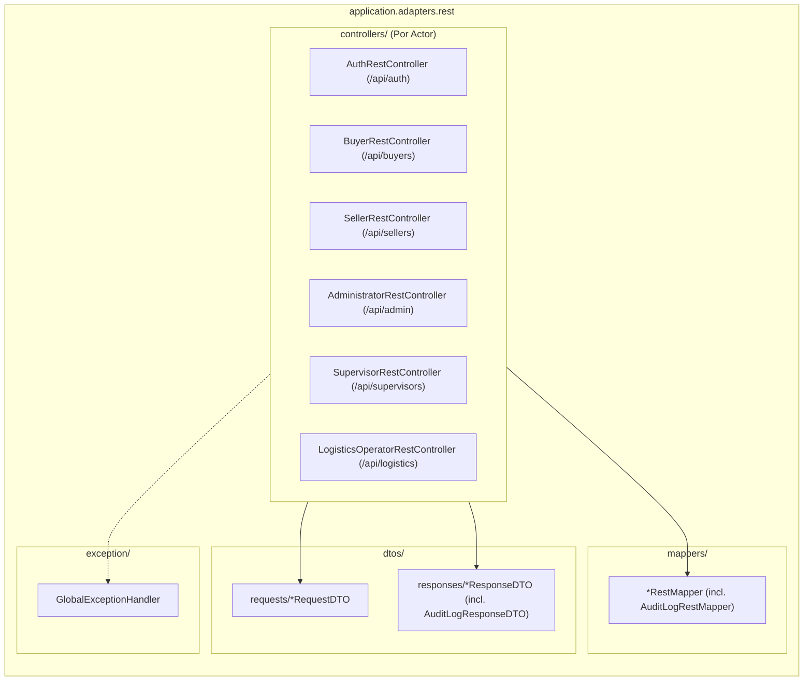

# C4 - Capa Adapters REST

## 1. Estructura y Componentes
La capa de adaptadores REST (`application.adapters.rest`) gestiona todas las interacciones HTTP externas mediante controladores organizados por Actor:

---

## 2. Puntos Clave de Implementación
1. **Separación DTO vs Entidad:** Los controladores nunca exponen modelos de dominio directamente; utilizan registros inmutables DTO.
2. **Transformación Pura:** `*RestMapper` traduce bidireccionalmente entre DTOs y modelos de dominio mediante componentes Spring reutilizables.
3. **Manejo de Errores Uniforme:** `GlobalExceptionHandler` intercepta cualquier fallo y produce `ApiErrorResponseDTO` con códigos HTTP estándar (400, 401, 404, 409, 500).
