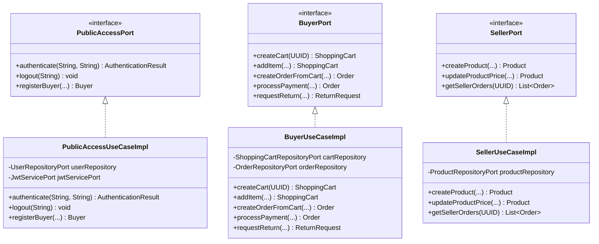

# C4 - Capa Adapters UseCases

## 1. Implementaciones de Casos de Uso por Actor
Los casos de uso residen bajo `application.adapters.useCases` y materializan los puertos de entrada por Actor:

---

## 2. Inyección de Dependencias
Todos los casos de uso implementan interfaces de puertos de actor (`*Port`) y son registrados como beans de Spring mediante `@Service`. Inyectan exclusivamente puertos de salida (`*RepositoryPort`, `*ServicePort`) y servicios de dominio para garantizar la pureza hexagonal.
