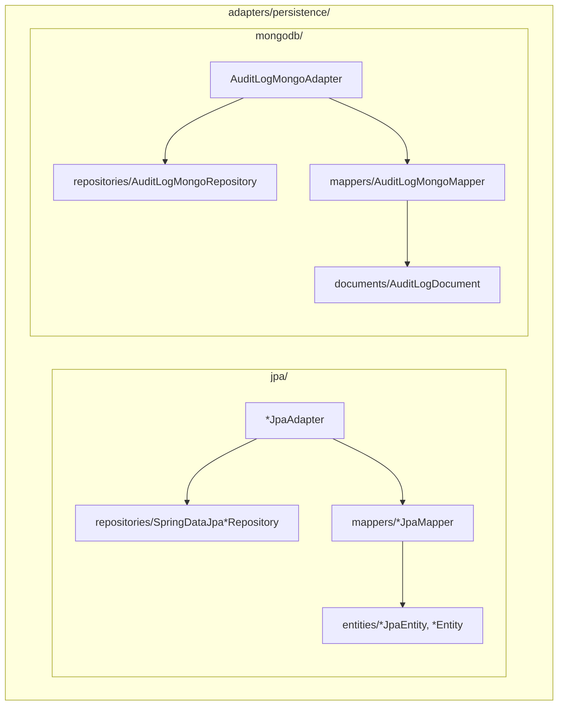

# C4 - Capa Adapters Persistence

## 1. Organización de Persistencia
La persistencia se organiza bajo `application.adapters.persistence`:

---

## 2. Aislamiento Tecnológico
Los modelos de dominio no contienen anotaciones de `@Entity`, `@Table`, `@Id` ni `@Document`. Es el mapper correspondiente quien realiza la conversión bidireccional entre la estructura de persistencia y el agregado de negocio.
