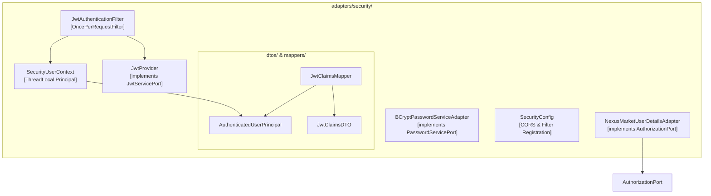

# C4 - Capa Adapters Security

## 1. Componentes de Seguridad
La capa `application.adapters.security` proporciona autenticación y autorización:

---

## 2. Inmutabilidad y Aislamiento por Hilo
El contexto de seguridad utiliza `ThreadLocal<AuthenticatedUserPrincipal>` asegurando que cada petición HTTP mantenga su propia identidad aislada, la cual es destruida en el bloque `finally` del filtro.
