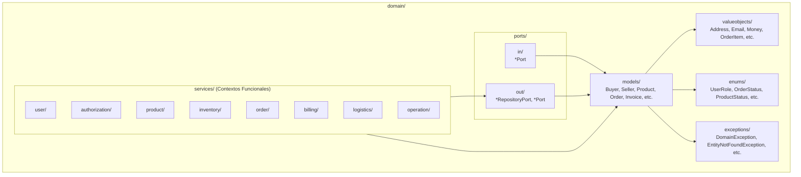

# C4 - Capa Domain (Núcleo Hexagonal)

## 1. Subpaquetes del Dominio
El núcleo agnóstico se organiza bajo `application.domain`:

---

## 2. Invariantes y Reglas de Negocio
El dominio concentra el 100% de las políticas y validaciones esenciales. No permite la existencia de estados inconsistentes (ej. productos con precios negativos o carritos con cantidades menores a 1).
