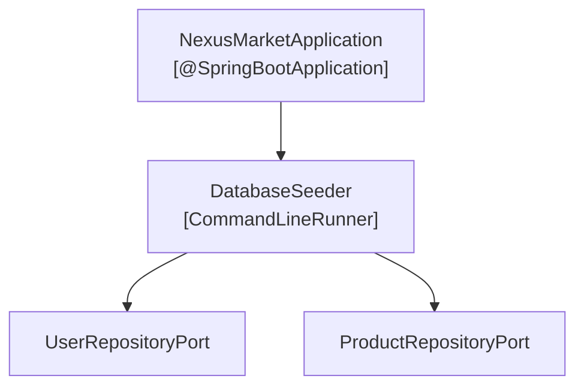

# C4 - Capa Infrastructure

## 1. Responsabilidad y Componentes
La capa de infraestructura (`application.infrastructure`) contiene la inicialización del microservicio:

---

## 2. Inicialización Automática (Seeding)
En cada arranque de la aplicación, el `DatabaseSeeder` verifica si existe el usuario administrador raíz (`admin@nexusmarket.com`) y productos iniciales de catálogo. Si la base de datos se encuentra vacía, procede con la carga automática de demostración.
