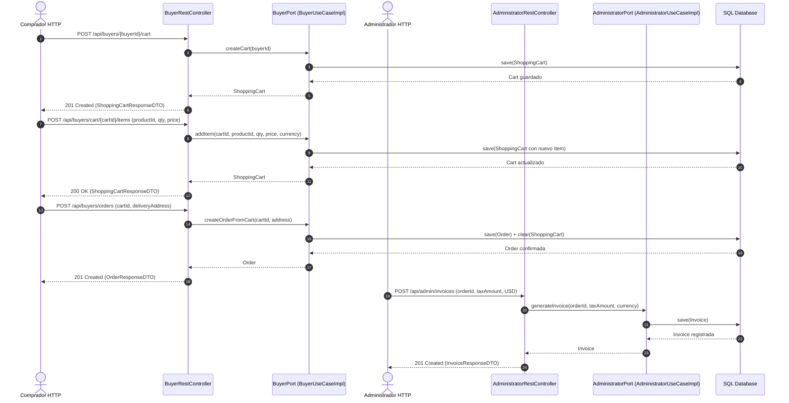
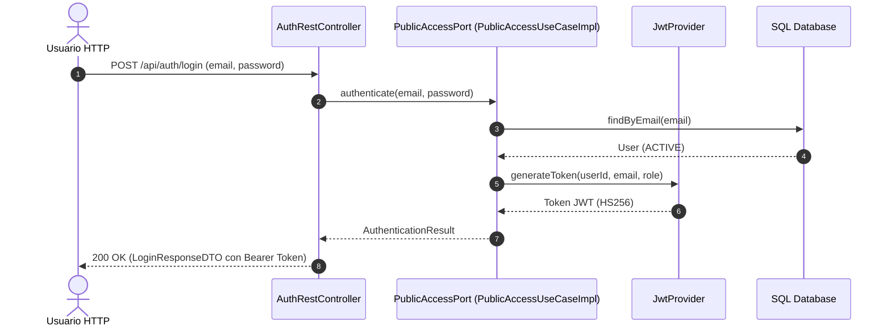

# C4 - Endpoints y Flujos de Negocio de la API

## 1. Flujo Completo de Creación de Orden y Facturación
En el modelo orientado a actores, el Comprador interactúa con `BuyerRestController` y la facturación se emite a través de `AdministratorRestController`:

---

## 2. Flujo de Autenticación y Autorización
La autenticación pública valida credenciales y entrega el token JWT para los flujos subsiguientes:

