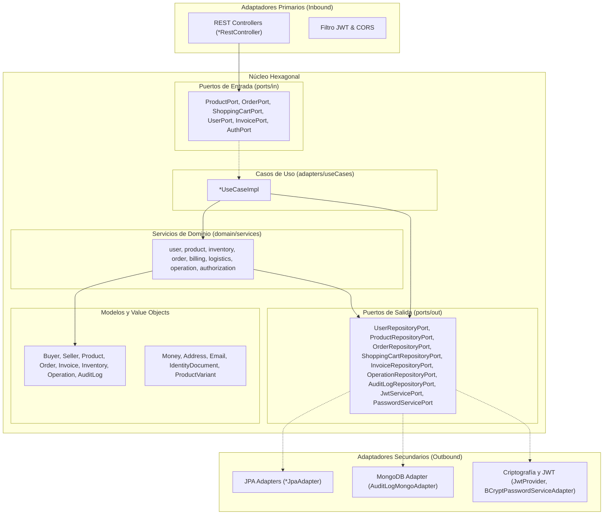

# Especificación de Arquitectura de Software: NexusMarket

## 1. Visión General y Estilo Arquitectónico
NexusMarket implementa **Arquitectura Hexagonal (Puertos y Adaptadores)** combinada con **Domain-Driven Design (DDD)**. El objetivo principal es aislar completamente el núcleo de negocio de cualquier detalle tecnológico, permitiendo que frameworks web, motores de bases de datos y servicios criptográficos sean componentes intercambiables conectados a través de puertos.

---

## 2. Descripción Detallada de Capas

### 2.1 Capa de Dominio (`application.domain`)
Es el corazón de la aplicación. No tiene dependencia de ninguna infraestructura ni framework externo.
- **`enums/`:** Clasificaciones y estados de entidades del negocio.
- **`models/`:** Entidades y agregados raíz que mantienen la identidad y encapsulan las reglas invariantes.
- **`valueobjects/`:** Objetos de valor inmutables identificados por sus atributos.
- **`exceptions/`:** Jerarquía de excepciones de negocio tipadas derivadas de `DomainException`.
- **`ports/in/`:** Contratos de los casos de uso disponibles para los actores externos.
- **`ports/out/`:** Interfaces de pasarelas de persistencia, seguridad y notificaciones.
- **`services/`:** Lógica de negocio orquestada dividida en 8 subpaquetes funcionales (`user`, `authorization`, `product`, `inventory`, `order`, `billing`, `logistics`, `operation`).

### 2.2 Capa de Adaptadores (`application.adapters`)
Conecta el mundo exterior con el núcleo de dominio:
- **`useCases/`:** Implementaciones de los puertos de entrada (`*UseCaseImpl`).
- **`rest/`:** Exposición HTTP REST (`controllers/`, `dtos/requests/`, `dtos/responses/`, `mappers/`, `exception/`).
- **`security/`:** Implementación de hashing de contraseñas (`BCryptPasswordServiceAdapter`), emisor/validador JWT (`JwtProvider`), filtros y contexto de seguridad thread-safe.
- **`persistence/jpa/`:** Implementación relacional SQL con Spring Data JPA y mapeadores dedicados.
- **`persistence/mongodb/`:** Implementación documental para bitácoras de auditoría en MongoDB.
- **`config/`:** Proveedor de parámetros de negocio en tiempo de ejecución.
- **`notification/`:** Pasarela de notificaciones multicanal.

### 2.3 Capa de Infraestructura (`application.infrastructure`)
Configuraciones y componentes del ciclo de vida del sistema:
- **`seed/DatabaseSeeder.java`:** `CommandLineRunner` que inicializa el administrador predeterminado y productos iniciales de demostración.
- **`NexusMarketApplication.java`:** Clase de arranque Spring Boot.

---

## 3. Persistencia Políglota y Gestión de Datos
- **Base de Datos Relacional (SQL Server / MySQL / H2):** Maneja las transacciones críticas con integridad referencial ACID (usuarios, productos, carritos, pedidos, facturas y operaciones).
- **Base de Datos NoSQL (MongoDB):** Maneja documentos de auditoría (`audit_logs`) con esquema flexible y alta velocidad de inserción para trazabilidad forense.
