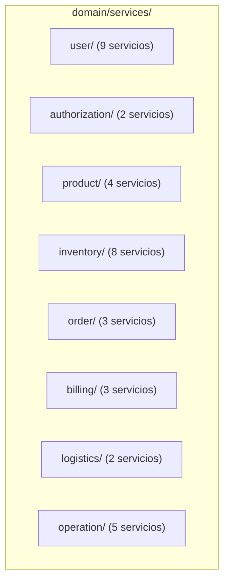

# Servicios de Dominio (Domain Services): NexusMarket

## 1. Visión General
Los servicios de dominio residen bajo `application.domain.services` organizados en 8 subpaquetes funcionales:

---

## 2. Distribución y Responsabilidades por Contexto

### 2.1 Contexto de Usuarios (`domain/services/user/`)
1. `UserInformationManagementService`: Registro y actualización de perfiles de usuario.
2. `AuthenticationAccessControlService`: Validación de acceso de usuario y estado activo.
3. `UniqueIdentityValidationService`: Validación de unicidad de email y documento de identidad en repositorios.
4. `UserOperationalStateService`: Bloqueo, activación y transiciones de estado de usuarios.
5. `BuyerManagementService`: Creación y control de cuentas de comprador.
6. `BuyerCommercialStateControlService`: Habilitación y suspensión comercial de compradores.
7. `SellerAdministrativeRegistrationService`: Onboarding y aprobación administrativa de vendedores.
8. `PrimaryAddressManagementService`: Asignación y actualización de la dirección principal.
9. `SecondaryAddressManagementService`: Gestión de libreta de direcciones adicionales.

### 2.2 Contexto de Autorización (`domain/services/authorization/`)
10. `RolePermissionManagementService`: Asignación de roles y verificación de permisos RBAC.
11. `AuthorizeActionService`: Validación granular de roles y permisos mediante `AuthorizationPort`.

### 2.3 Contexto de Catálogo de Productos (`domain/services/product/`)
12. `ProductCatalogManagementService`: Publicación y mantenimiento de catálogo.
13. `ProductStateControlService`: Transiciones de estado (`PUBLISHED`, `SUSPENDED`, `DISCONTINUED`).
14. `ProductTypeDifferentiationService`: Reglas específicas para productos físicos vs digitales.
15. `ProductVariantManagementService`: Gestión de combinaciones y variantes de producto.

### 2.4 Contexto de Inventario y Almacenes (`domain/services/inventory/`)
16. `CriticalStockValidationService`: Monitoreo y alerta de umbrales mínimos de stock.
17. `DistributedInventoryManagementService`: Balanceo de existencias entre almacenes.
18. `InventoryAdjustmentsReturnsService`: Reingreso de stock tras devoluciones aprobadas.
19. `InventoryEntryRegistrationService`: Registro de compras y entradas a almacén.
20. `InventoryReservationService`: Bloqueo preventivo de existencias para carritos activos.
21. `SalesExitRegistrationService`: Descuento definitivo de inventario por orden confirmada.
22. `WarehouseClassificationService`: Tipificación de almacenes (central, regional, despacho).
23. `WarehouseInformationControlService`: Actualización y estado de almacenes físicos.

### 2.5 Contexto de Carritos y Pedidos (`domain/services/order/`)
24. `ShoppingCartManagementService`: Adición, cálculo y limpieza de carritos.
25. `OrderStatusMonitoringService`: Vigilancia del ciclo de vida de pedidos.
26. `CompletedOrderImmutabilityService`: Garantía de inmutabilidad en pedidos completados o facturados.

### 2.6 Contexto de Facturación y Finanzas (`domain/services/billing/`)
27. `BillingAdministrationService`: Emisión de facturas y cálculo fiscal de impuestos.
28. `RefundsManagementService`: Liquidación y emisión de reembolsos monetarios.
29. `AdministrativeReportsConsolidationService`: Consolidación contable de ingresos y ventas.

### 2.7 Contexto de Logística y Envíos (`domain/services/logistics/`)
30. `LogisticsShippingManagementService`: Despacho y seguimiento de paquetes físicos.
31. `ReturnsAdministrationService`: Gestión de solicitudes y validación de devoluciones.

### 2.8 Contexto de Operaciones y Auditoría (`domain/services/operation/`)
32. `RegisterOperationService`: Registro de transacciones operativas en base de datos SQL.
33. `RegisterAuditLogService`: Registro inmutable de eventos en MongoDB.
34. `RegisterOperationAndAuditService`: Orquestación atómica de doble registro (SQL + MongoDB).
35. `ConsultOperationsService`: Consulta de historial operativo.
36. `ConsultAuditLogsService`: Consulta forense de bitácoras de auditoría.
